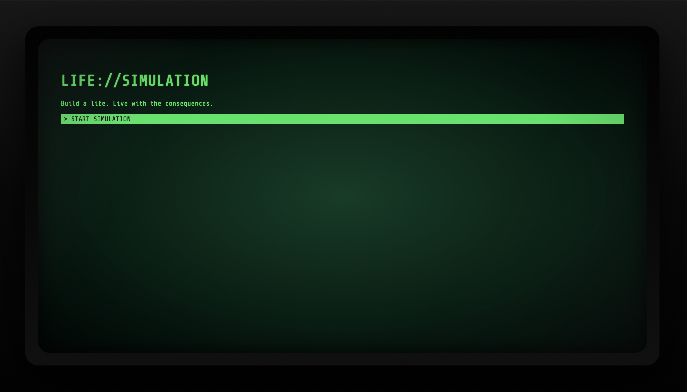
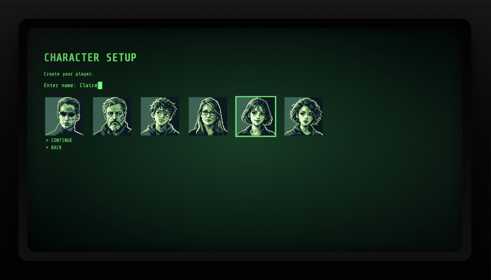
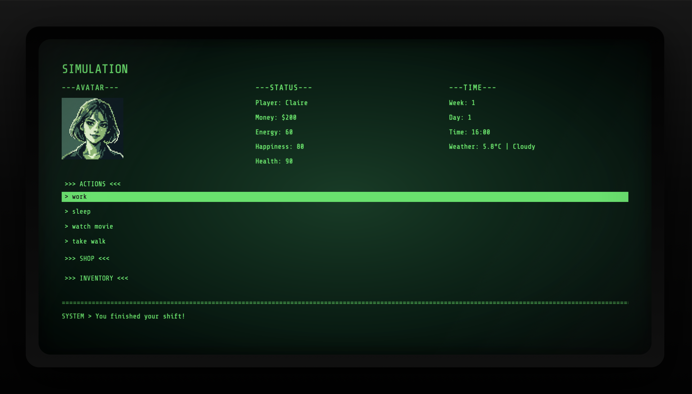
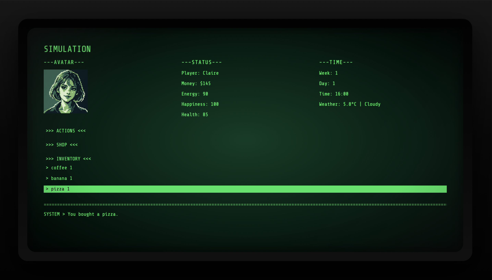
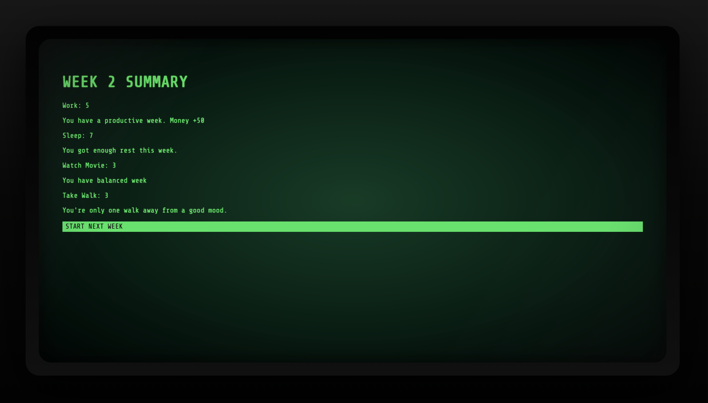
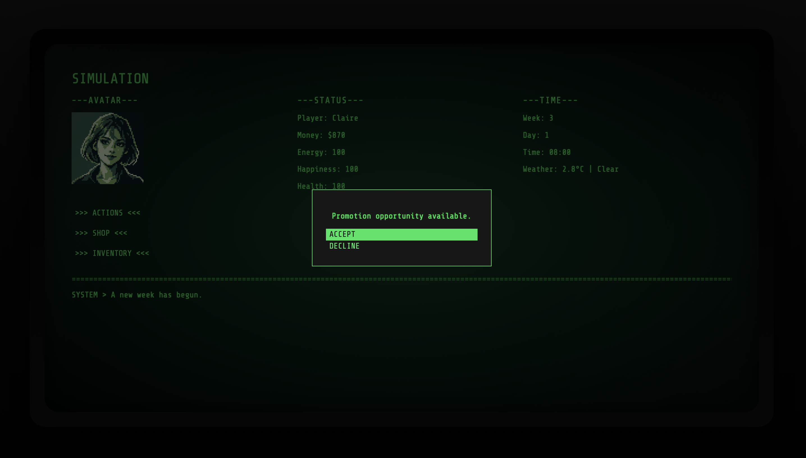

# LIFE://SIMULATION

**Every choice has a cost.**

*A browser-based life simulation game about choices, limited resources, and unexpected consequences.*

**Status: Functional Prototype | MVP in Development**

## About the Game

LIFE://SIMULATION is an experimental, decision-driven life simulation game built with React and JavaScript.

Players manage a character's everyday life while balancing limited time, money, energy, happiness, and health.

Working earns money but consumes energy. Resting helps recovery but costs valuable time. Unexpected events create new opportunities and problems, while previous decisions can affect future gameplay.

The goal is not to recreate every aspect of real life, but to build an engaging simulation around meaningful trade-offs.

## Core Gameplay Loop

The game follows a day-based system with weekly progression.

**Plan your day → Choose activities → Manage resources → Experience consequences → Sleep → Start a new day**

After seven days, the player receives a weekly summary and continues into the next week.

## Gameplay Preview

### Start Simulation


### Character Creation


### Daily Simulation


### Shop & Inventory


### Weekly Progression


### Events & Player Choices


## Current Features

### Character & Player Stats

- Character naming and avatar selection
- Money, energy, happiness, and health management
- Stat limits and validation
- Game Over when health reaches zero
- Restarting the simulation

### Actions & Time Management

- Four core actions: Work, Sleep, Watch Movie, and Take Walk
- Actions affect time and player resources
- Daily action limits
- Maximum of five work shifts per week
- Day and week progression
- Weekly activity summary

### Shop & Inventory

- Purchasable consumable items
- Inventory with item quantities
- Separate buying and consuming mechanics
- Item effects on player stats
- Automatic removal of consumed items

### Events & Consequences

- Reusable, data-driven event system
- Events with multiple player choices
- Broken phone event with a persistent income penalty
- Party invitation event
- Event history tracking
- Promotion opportunities with long-term work-related trade-offs

### Weather Integration

- Weather data fetched from an external API
- Weather conditions displayed in the simulation
- Weather-dependent gameplay effects, including walking rewards
- Loading and error handling

### User Interface

- Terminal-inspired visual design
- Dark interface with green accents
- Expandable action, shop, and inventory panels
- Event and opportunity overlays
- Weekly summary and Game Over screens

## Technologies

- React
- JavaScript (ES6+)
- HTML5
- CSS3
- Vite
- REST API integration
- Git & GitHub

## Technical Highlights

The project explores practical frontend development concepts through game systems rather than isolated tutorial exercises.

Key areas include:

- React state management with `useState` and `useEffect`
- Reusable components and props
- Conditional rendering
- Functional and immutable state updates
- Data-driven actions and event definitions
- JavaScript array methods and object manipulation
- Managing interconnected gameplay systems
- Debugging, refactoring, and manual playtesting

Game data is organized separately from the main application logic, including action definitions, events, shop items, and configuration.

## Running the Project Locally

**Requirements:** Node.js and npm.

Clone the repository and open its directory.

Install dependencies:

```bash
npm install
```

Start the development server:

```bash
npm run dev
```

Open the local address displayed in the terminal.

Some weather-related functionality depends on an external API and internet connectivity.

## Current Development Status

The game has a functional prototype with daily and weekly progression, resource management, events, shopping, inventory, and basic long-term consequences.

However, the MVP is not yet complete.

### Development Roadmap

- [ ] Implement a weekly financial goal / rent system
- [ ] Expand the event pool
- [ ] Introduce additional persistent consequences
- [ ] Improve event integration into the daily loop
- [ ] Balance activities, rewards, and penalties
- [ ] Refactor larger gameplay components
- [ ] Improve responsive design and accessibility
- [ ] Add systematic gameplay testing
- [ ] Explore persistent save functionality

### Current MVP Goal

**Make one simulated week genuinely fun.**

The priority is to create interesting decisions through a small number of interconnected systems rather than adding dozens of unrelated activities.

## About the Developer

I'm a Digital Game Theory student at the University of Ss. Cyril and Methodius in Trnava, Slovakia.

My background includes advertising design, UX/UI education, and frontend development.

LIFE://SIMULATION is an independent personal project through which I develop my React and JavaScript skills while exploring interactive game systems, decision-making mechanics, and UI design.

I use AI assistance as a learning tool for programming explanations, code review, debugging, and technical problem-solving, with an emphasis on developing independent development skills.

## Project Status

**Work in Progress — Not a Finished Game**

This repository documents the ongoing development of LIFE://SIMULATION. Implemented systems are subject to change as gameplay is tested, balanced, and expanded.
